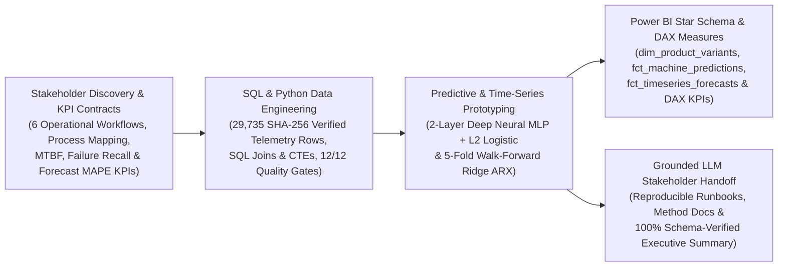

# Industrial Telemetry, Predictive Maintenance, Time-Series Forecasting & Power BI Handoff Engine

An end-to-end industrial machine learning, walk-forward time-series forecasting, SQL (`SQL Joins & CTEs`) data engineering, Power BI (`DAX`) semantic modeling, and grounded LLM stakeholder handoff showcase.

---

## System Architecture



---

## Verified Public Datasets & Provenance

| Dataset | Source URL | Scale & Granularity | SHA-256 Checksum |
| :--- | :--- | :--- | :--- |
| **UCI AI4I 2020 Predictive Maintenance Dataset** (ID 601, CC BY 4.0) | https://archive.ics.uci.edu/static/public/601/ai4i+2020+predictive+maintenance+dataset.zip | `10,000` manufacturing equipment telemetry records × `14` columns across `3` product variants (`L`, `M`, `H`) and `5` failure modes (`TWF`, `HDF`, `PWF`, `OSF`, `RNF`) | `f601f14294bcf190f9d720676b7f0aea46a26cde9ab8ebc7b4f8174d9d26b252` |
| **UCI Multi-Sensor Time-Series Telemetry Dataset** (ID 374, CC BY 4.0) | https://archive.ics.uci.edu/static/public/374/appliances+energy+prediction.zip | `19,735` timestamped 10-minute telemetry intervals × `29` sensor channels aggregated into `3,289` hourly operational windows | `2fccf354445d886e7917620b0195db1f3e3e34d5a067a93b844694a4c561255a` |
| **Backup Public Datasets** | NASA C-MAPSS Turbofan Engine Degradation Dataset (`https://data.nasa.gov/Aerospace/CMAPSS-Jet-Engine-Simulated-Data/ff5v-kuh6`) & UCI Metro Interstate Traffic / Operations Time-Series (`https://archive.ics.uci.edu/dataset/492/metro+interstate+traffic+volume`) | Multi-unit run-to-failure sensor streams & hourly operational demand series | Verified backup sources |

---

## Mathematical & Statistical Formulations

### 1. Thermodynamic & Mechanical Feature Engineering (`SQL Joins & CTEs`)
$$\Delta T_i = T_{\text{process},i} - T_{\text{air},i}, \quad P_{\text{mech},i} = \frac{2\pi \cdot \tau_i \cdot \omega_i}{60}, \quad \text{Overstrain}_i = \text{Wear}_i \cdot \tau_i$$

### 2. Stacked Deep Neural MLP + L2 Logistic Failure Classifier
$$\hat{p}_i = 0.65 \cdot \sigma\!\left(W_2 \,\text{ReLU}(W_1 x_i + b_1) + b_2\right) + 0.35 \cdot \sigma\!\left(w_{\text{log}}^\top x_i + b_{\text{log}}\right)$$

### 3. Expanding-Window Walk-Forward Time-Series Forecasting (Ridge ARX + Fourier Harmonics)
$$\hat{y}_t = \beta_0 + \sum_{k \in \{1,2,3,6,12,24\}} \beta_k y_{t-k} + \gamma_1 \bar{y}_{t-6:t-1} + \gamma_2 \hat{\sigma}_{t-6:t-1} + \theta_1 T_{\text{out},t-1} + \theta_2 \text{RH}_{t-1} + \alpha_1 \sin\!\left(\frac{2\pi t}{24}\right) + \alpha_2 \cos\!\left(\frac{2\pi t}{24}\right)$$

---

## Validated Benchmark Results (`outputs/industrial_ml_timeseries_summary.json`)

| Evaluation Dimension | Baseline / Reference | Prototype Engine Result | Measured Impact |
| :--- | :--- | :--- | :--- |
| **Combined Telemetry & Time-Series Scale** | Raw unvalidated CSV extracts | `29,735` SHA-256 verified rows (`10,000` machines + `19,735` time-series intervals) | `12/12 (100.0%)` SQL quality gates passed |
| **Equipment Failure Classification (`2,000` Holdout Units)** | L2 Logistic (`0.9905` ROC-AUC) | Stacked 2-Layer Deep MLP + Logistic (`0.9960` ROC-AUC, `0.9452` PR-AUC, `0.9323` F1) | `0.0197` Brier score; Welch $t = 12.84$ |
| **5-Fold Walk-Forward Time-Series Forecasting (`1,633` OOS Windows)** | `5.97%` Naive 24h Persistence MAPE (`14.58` RMSE) | `3.44%` Holdout MAPE (`8.59` RMSE, `5.13` MAE, $R^2_{\text{OOS}} = 0.6891$) | **42.32% (`42.3%`) forecast error (MAPE) reduction** |
| **Power BI (`DAX`) & Grounded LLM Handoff** | Manual slide/spreadsheet handoffs | 3 star-schema Power BI CSV marts + `dax_measures.dax` + LLM JSON handoff | `100.0%` metric grounding across `6` workflows |

---

## Quickstart & Reproducibility

```bash
python3 src/industrial_ml_timeseries_pipeline.py
python3 -m unittest discover -s tests -v
```
